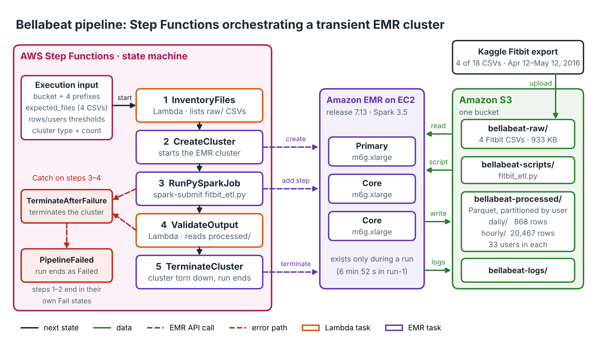
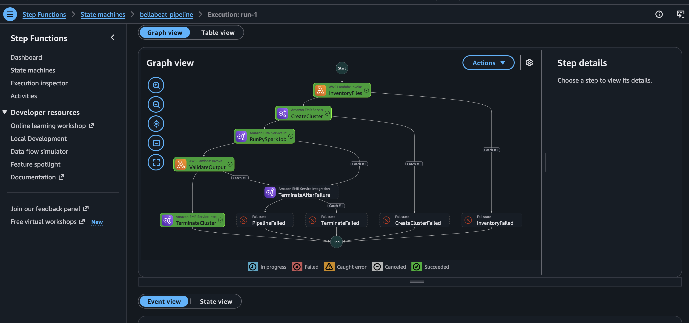

# Bellabeat Pipeline

AWS Step Functions orchestrates a transient Amazon EMR cluster that runs a PySpark job over four Fitbit CSVs and writes two Parquet datasets to S3. Two Lambda functions check the inputs before the cluster starts and check the output before it shuts down.



Step Functions calls the EMR API. The cluster reads from and writes to S3 directly. Nothing in this stack bills while idle; the cluster exists only during an execution.

## Data

Kaggle "FitBit Fitness Tracker Data" (Möbius, CC0). The download has 29 CSVs in two date-range folders. This pipeline uses only the Apr 12 – May 12, 2016 folder (18 files), because `sleepDay_merged.csv` does not exist in the Mar 12 – Apr 11 folder.

| Input | Grain | Rows | Users |
|---|---|---|---|
| `dailyActivity_merged.csv` | day | 940 | 33 |
| `sleepDay_merged.csv` | day | 413 | 24 |
| `hourlySteps_merged.csv` | hour | 22,099 | 33 |
| `weightLogInfo_merged.csv` | log entry | 67 | 8 |

Total input: 932,675 bytes. Observation window: 31 days.

## What the PySpark job does

- Reads each CSV with an explicit schema and `FAILFAST`
- Drops 3 exact duplicate rows in `sleepDay`
- Removes a day only if `TotalSteps = 0` and `SedentaryMinutes = 1440` (72 of 940 days)
- Fails if (Id, date) is not unique in any daily-grain input
- Left-joins activity to sleep and weight on (id, date)
- Adds `day_of_week`, `logs_sleep`, `logs_weight`, `days_logged`
- Keeps only hourly rows that fall on a kept day
- Writes `daily/` and `hourly/` as Parquet, partitioned by `user_part` (a copy of `id`, so `id` stays inside every file)
- Session time zone is UTC so timestamps read the same locally and on EMR

## Files

| File | Purpose |
|---|---|
| `profile_inputs.py` | Profiles the raw CSVs (row counts, duplicates, zero-activity candidates). Run once, before the ETL was written |
| `fitbit_etl.py` | The PySpark job. `spark-submit fitbit_etl.py --input <dir> --output <dir>` (local paths or `s3://` URIs) |
| `inventory_lambda.py` | Lambda: checks the expected CSVs exist under the raw prefix and are non-empty. Raises `MissingInputFiles` |
| `validate_lambda.py` | Lambda: for each dataset checks `_SUCCESS`, Parquet footer row count, distinct `user_part=` partitions, and `id` in every file's schema. Raises `OutputValidationFailed` with every failure listed |
| `test_inventory_local.py` | Runs the inventory Lambda against a local folder through a fake S3 client |
| `test_validate_local.py` | Runs the validation Lambda against local Spark output through a fake S3 client |
| `state_machine.json` | Step Functions definition (ASL). `${...}` placeholders are filled by CloudFormation |
| `execution_input.json` | All runtime config: bucket, prefixes, expected files, row/user thresholds, EMR release, instance type, node count, idle timeout |
| `bootstrap.yaml` | CloudFormation: the S3 bucket only (retained on stack delete) |
| `pipeline.yaml` | CloudFormation: VPC and subnet, both Lambdas, log groups, IAM roles, state machine |
| `arch_diagram.py` | Generates `screenshots/p3_00_architecture.png` |
| `screenshots/` | Images used in the post |

## State machine

1. **InventoryFiles** — Lambda. Fails to `InventoryFailed`.
2. **CreateCluster** — EMR `createCluster.sync`. 1 primary + 2 core nodes. Fails to `CreateClusterFailed`.
3. **RunPySparkJob** — EMR `addStep.sync`, runs `fitbit_etl.py` with `spark-submit`.
4. **ValidateOutput** — Lambda.
5. **TerminateCluster** — EMR `terminateCluster.sync`.

If step 3 or 4 fails, the Catch goes to `TerminateAfterFailure` (retried 3 times), then `PipelineFailed`. If that termination fails too, the execution ends in `TerminateFailed`. Steps 1 and 2 fail directly because no cluster exists yet. Lambda states retry on transient Lambda errors. The success-path `TerminateCluster` retries but has no Catch, so if it fails the execution fails and the 900-second idle auto-termination is what shuts the cluster down.

## Prerequisites

- AWS CLI v2, authenticated, default region `us-east-1`
- For local tests: Java 17 (Amazon Corretto 17), Python 3.11, `pyspark==3.5.6` — matches EMR 7.13.0. The Lambda tests also need `pyarrow`

## Test locally

```sh
DATA="<path to>/Fitabase Data 4.12.16-5.12.16"
spark-submit fitbit_etl.py --input "$DATA" --output ~/bellabeat-out
python test_inventory_local.py "$DATA"
python test_validate_local.py ~/bellabeat-out
```

## Deploy

Networking: `AmazonEMRServicePolicy_v2` only launches into subnets and VPCs tagged `for-use-with-amazon-emr-managed-policies=true`, so `pipeline.yaml` builds its own tagged VPC and public subnet instead of using the default VPC.

```sh
# 1. Bucket
aws cloudformation deploy --stack-name bellabeat-bootstrap \
  --template-file bootstrap.yaml

# 2. Inputs and script
aws s3 cp "$DATA/dailyActivity_merged.csv" s3://bellabeat-pipeline-drew/bellabeat-raw/
aws s3 cp "$DATA/sleepDay_merged.csv" s3://bellabeat-pipeline-drew/bellabeat-raw/
aws s3 cp "$DATA/hourlySteps_merged.csv" s3://bellabeat-pipeline-drew/bellabeat-raw/
aws s3 cp "$DATA/weightLogInfo_merged.csv" s3://bellabeat-pipeline-drew/bellabeat-raw/
aws s3 cp fitbit_etl.py s3://bellabeat-pipeline-drew/bellabeat-scripts/

# 3. Package (uploads Lambda code and the ASL) and deploy
aws cloudformation package --template-file pipeline.yaml \
  --s3-bucket bellabeat-pipeline-drew --s3-prefix bellabeat-artifacts \
  --output-template-file packaged.yaml
aws cloudformation deploy --stack-name bellabeat-pipeline \
  --template-file packaged.yaml --capabilities CAPABILITY_IAM
```

The bucket name is a template parameter (`BucketName`). If you change it, change it in `execution_input.json` too. Don't commit `packaged.yaml`.

## Run

```sh
SM=$(aws cloudformation describe-stacks --stack-name bellabeat-pipeline \
  --query "Stacks[0].Outputs[?OutputKey=='StateMachineArn'].OutputValue" \
  --output text)
aws stepfunctions start-execution --state-machine-arn "$SM" \
  --name run-1 --input file://execution_input.json
```

Execution names must be unique per state machine, so use `run-2`, `run-3` and so on for later runs.

## Verify

```sh
aws stepfunctions describe-execution --execution-arn <executionArn from start-execution> \
  --query status
aws emr list-clusters --active
```

`list-clusters --active` should return an empty list once the execution has ended, whether it succeeded or failed. Check it after every run.

## Teardown

```sh
aws cloudformation delete-stack --stack-name bellabeat-pipeline
aws cloudformation delete-stack --stack-name bellabeat-bootstrap
```

Delete `bellabeat-pipeline` first. `bellabeat-bootstrap` keeps the bucket on delete (`DeletionPolicy: Retain`) because the next project loads the Parquet output from it. To remove the bucket as well: `aws s3 rb s3://bellabeat-pipeline-drew --force`.

## Results (run-1, 2026-10-14)

| Measure | Value |
|---|---|
| Execution, start to stop | 7 min 22 s |
| Cluster lifetime, created to terminated | 6 min 52 s |
| Cluster | EMR 7.13.0, 3 × m6g.xlarge (Graviton) |
| Inventory | 4 of 4 expected files found |
| `daily/` | 33 Parquet files, 868 rows, 33 users, 0 files missing `id` |
| `hourly/` | 33 Parquet files, 20,467 rows, 33 users, 0 files missing `id` |
| Local run vs EMR run | identical on every validated measure |
| Clusters still active after the run | 0 |



Activity days went from 940 to 868 (72 removed, 7.7%). Hourly rows went from 22,099 to 20,467 (1,632 removed). 24 users logged sleep and 8 logged weight.

## Cost

What bills during a run: the three EC2 nodes plus the EMR charge (per second, 1-minute minimum), one public IPv4 address per node, and the nodes' EBS volumes. Nothing bills between runs except a few MB of S3 storage. EMR logs and package uploads expire after 30 days.

## Known limits

- Spark is far more than this data needs: a 3-node cluster ran for almost 7 minutes to process 933 KB. The job is written this way to show the pattern. At this size pandas or DuckDB on one machine would do it.
- `validate_lambda.py` downloads each Parquet object whole to read its footer. Fine at a few MB; a larger dataset would need ranged reads of the footer only.
- The subnet sits in the region's first Availability Zone. If CreateCluster fails with a capacity error, change `instance_type` in `execution_input.json`.
