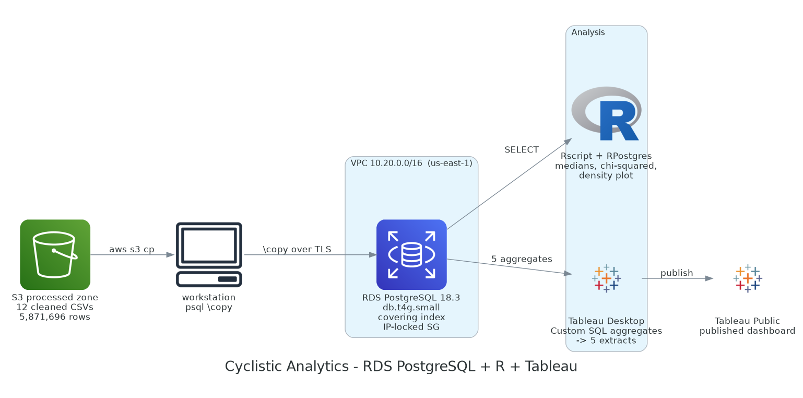

# Cyclistic Analytics — RDS PostgreSQL + R + Tableau

Analysis of 5,871,696 Chicago bike-share trips to answer one
question: **how do annual members and casual riders use the
bikes differently?**

The cleaned output of
[cyclistic-pipeline](../cyclistic-pipeline/) is loaded into
Amazon RDS for PostgreSQL, aggregated in SQL, tested in R,
and presented as a five-view Tableau dashboard.

**Live dashboard:**
https://public.tableau.com/app/profile/andrew.daniels3278/viz/CyclisticHowMembersandCasualRidersRideDifferently/CyclisticDashboard

Note the shape of the load path: **S3 does not connect to
RDS.** RDS PostgreSQL cannot `COPY` directly from `s3://`
(that is Redshift), so the twelve cleaned CSVs are pulled to
the workstation and loaded with client-side `\copy`.

---

## What's here

| File | What it is |
|---|---|
| `template.yaml` | CloudFormation: VPC, subnets, IGW, security group, RDS instance |
| `schema.sql` | Table DDL, the BOOLEAN cast, VACUUM ANALYZE, covering index — in execution order |
| `analysis_queries.sql` | The six aggregation queries behind every chart |
| `analysis.R` | Pooled medians, chi-squared with effect size, density plot |
| `diagram.py` | Generates the architecture diagram above |
| `data/` | The five aggregate exports that feed the dashboard |
| `screenshots/` | Console captures and generated figures |

`AllowedCidr` in `template.yaml` is a required parameter with
no default. Get yours with
`curl -s https://checkip.amazonaws.com`.

## Reproducing

1. Run [cyclistic-pipeline](../cyclistic-pipeline/) to
   produce the twelve cleaned CSVs.
2. `aws cloudformation deploy` with `template.yaml`, passing
   your own `/32` and a DB password.
3. Run `schema.sql` steps 1, 3, 4 and 5 in `psql`, with the
   twelve `\copy` loads between steps 1 and 3.
4. `analysis_queries.sql` reproduces every figure below.

You can skip all of it. The five CSVs in `data/` are the
exported query results, so every chart is reproducible
without a database.

---

## Findings

Every number below comes from a population query against all
5,871,696 rows. Nothing here is sampled.

### Casual rides are longer, but not "twice as long"

| user | rides | mean min | median min |
|---|---|---|---|
| casual | 2,068,884 | 18.93 | 11.48 |
| member | 3,802,812 | 12.27 | 8.75 |

Mean ratio **1.54×**, median ratio **1.31×**.

That single ratio hides a much wider range. Split by bike
type, the casual/member median gap is **1.19× within
electric bikes** but **1.73× within classic bikes**. Casual
riders take proportionally more electric rides, electric
rides are shorter for everyone, and that compresses the
pooled figure. Quote the pooled number alone and you are
hiding a 1.19×–1.73× spread.

### Both groups peak at 5pm

Members are genuinely bimodal — 7.30% of their rides at
08:00, a trough of 3.96% at 10:00, a peak of 10.78% at
17:00. Casual riders have **no midday spike**: their top
three hours are 17, 16 and 18, the same three as members, in
the same order.

The divergence is at the ends of the day:

| window | member % | casual % | skew |
|---|---|---|---|
| 06–08 | 15.79 | 7.38 | 2.14× member |
| 16–18 | 28.64 | 26.36 | 1.09× — shared |
| 22–02 | 5.59 | 9.98 | 1.79× casual |

Splitting the morning by weekday and weekend confirms it is
not a composition artifact. Weekday 06–09 runs **4.13×
member-skewed** against a 1.84× dataset baseline; weekend
mornings sit slightly *below* baseline. And within the
mornings casuals do ride, the hourly shape matches members'
almost exactly — both weekday curves peak at 8.

**The difference is frequency, not timing.** Casual riders
are not unavailable in the morning. They are not commuting
by bike.

### Casual demand concentrates, member demand spreads

Casual top-10 start stations span **5.17×** from first to
tenth (Navy Pier 49,005 → Adler Planetarium 9,475). Member
stations span **1.39×** (19,905 → 14,353). Casual demand
piles onto a few lakefront destinations; member demand
spreads along the Canal/Clinton commuter-rail corridor.

Navy Pier is also #10 for members — the split is not
disjoint.

Station queries filter on `has_station_names`. **32.4% of
rows have no station name** (dockless e-bike rides). The
bike-type query deliberately does *not* filter, because
doing so would systematically drop e-bikes.

### Bike type is a trap

| user | classic | electric |
|---|---|---|
| casual | 29.39% | 70.61% |
| member | 33.60% | 66.40% |

χ² = 10,934, df = 1, p < 2.2e-16 — and **Cramér's V =
0.0432**.

At 5.87M rows a significance test fires almost
automatically. V of 0.043 on a 0–1 scale says the 4.2-point
gap is not something to build a campaign on. Reporting the
p-value alone would be technically true and substantively
misleading.

### Seasonality: both groups swing

Casual volume swings **14.5×** across the year (345,480 in
July → 23,878 in January). Member volume swings **4.6×**
(500,388 → 109,865). Casuals swing roughly three times
harder — but members do not "stay consistent."

| month | member | casual | casual share % |
|---|---|---|---|
| 2025-07 | 38 | 61 | 61.62 |
| 2025-08 | 443,130 | 323,533 | 42.20 |
| 2025-09 | 440,954 | 254,727 | 36.62 |
| 2025-10 | 414,094 | 214,380 | 34.11 |
| 2025-11 | 251,924 | 94,719 | 27.32 |
| 2025-12 | 109,371 | 27,088 | 19.85 |
| 2026-01 | 109,865 | 23,878 | 17.85 |
| 2026-02 | 157,240 | 40,077 | 20.31 |
| 2026-03 | 223,654 | 84,812 | 27.49 |
| 2026-04 | 308,480 | 127,026 | 29.17 |
| 2026-05 | 399,522 | 235,873 | 37.12 |
| 2026-06 | 444,152 | 297,230 | 40.09 |
| 2026-07 | 500,388 | 345,480 | 40.84 |

> **Why thirteen months.** Divvy names each file by the month
> it *ends*, so 99 rides that started before midnight on
> 2025-07-31 sit inside the `202508` file. They are shown
> here and excluded from the dashboard's monthly chart,
> where 99 rides split across two series render as a false
> vertical launch from zero. The dashboard covers
> **Aug 2025 – Jul 2026**. Column totals reconcile to
> 5,871,696 either way.

---

## Performance

The draft of this project planned three single-column
indexes on `member_casual`, `day_of_week` and `started_at`.
The query plan showed they would address neither dominant
cost: a btree on a two-value column cannot beat a sequential
scan when every row is read, and none of them removes the
sort. One covering index on
`(member_casual, day_of_week, ride_length)` does both.

| condition | sort | exec time |
|---|---|---|
| post-VACUUM, 4 MB work_mem (baseline) | external merge, 202 MB | 14.53 s |
| 256 MB work_mem | external merge, 202 MB | 12.22 s |
| 1 GB work_mem | quicksort, 422 MB | 10.80 s |
| **4 MB + covering index** | **none — index supplies order** | **3.21 s** |

**4.5×**, not the order of magnitude the draft claimed.

Three things that are easy to get wrong here:

- **`VACUUM ANALYZE` is load-bearing.** The BOOLEAN cast
  rewrote the table, leaving the visibility map empty and
  stats stale. Measuring before vacuuming would have
  credited the index with a 5.8× gain that was really table
  maintenance. `Heap Fetches: 0` requires a current
  visibility map.
- **"Fewer disk reads" is not "less work."** `shared read`
  fell 90,367 → 29,859, but `shared hit` rose 52,340 →
  426,966. Total buffers touched went *up*.
- **The index is query-shape specific.** The hour-of-day
  query filters on `started_at`, which is not in the index,
  and still sequential-scans at ~10 s.

`work_mem` tuning was tested and rejected: the in-memory
sort needs 422 MB, and 1 GB of `work_mem` on a 2 GB instance
would OOM under concurrency. ~25% gain for 250× the memory.

---

## Notes on the artifacts

**The Tableau workbook is not in this repo.** A `.twbx` is a
zip archive, and `unzip` + `grep` finds the full RDS endpoint
hostname in plaintext inside the packaged `.twb`. The
published dashboard is linked above and opens without
Tableau Desktop, and `data/` holds every figure behind it.

**`analysis.R` was reconstructed.** The original ran
interactively via `Rscript` and was never saved to a file.
Every query in it reproduces figures recorded at the time,
but it has not been re-executed — the RDS instance was
deleted once the Tableau extracts were built. Analysis run
interactively is analysis you cannot commit.

**The density plot normalises each curve to area 1
independently.** It shows shape, not volume. Casual
n=2,068,884 against member n=3,802,812, so the fat casual
tail represents a smaller population than it appears to.

**Sampling.** The density plot uses `TABLESAMPLE SYSTEM (2)`,
which samples pages rather than rows; rows within a page are
correlated, so the effective sample is smaller than the row
count. No published number comes from it. `set.seed()` does
not make it reproducible — the sampling runs server-side in
Postgres, which ignores R's RNG.

---

## Cost

RDS is the first resource in this portfolio that bills while
idle. The instance ran for roughly two hours total across
the analysis and dashboard sessions, at ~$0.032/hour for
`db.t4g.small` in `us-east-1`, and was deleted as soon as
the Tableau extracts were built. Extracts rather than a live
connection is what made that possible — and it was the
reason extracts were chosen at the start, not a
rationalisation afterwards.

The honest version: only about 45 minutes of that uptime was
productive. The rest was licensing and UI troubleshooting
that could have happened with the database stopped.
